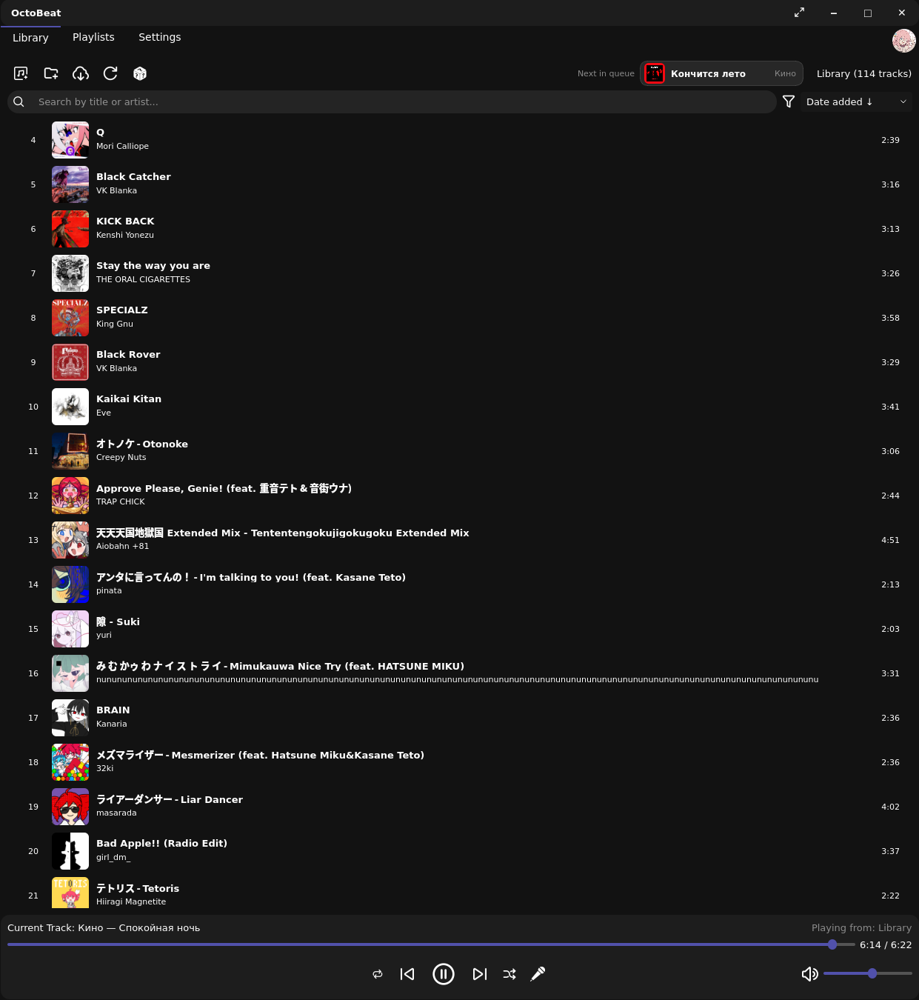

# OctoBeat

[](LICENSE)

OctoBeat is a local music player with YouTube search, downloads, playlists,
cover art, lyrics, MPRIS media keys and a native Rust audio engine.

This is the Rust/Qt rewrite. The old Python application is not used by this
repository.



## Features

- Native Rust audio engine: Opus, FLAC (24-bit/192 kHz), MP3, AAC/M4A,
  ADTS, Ogg/Vorbis, ALAC, AIFF, CAF; WASAPI/ALSA/PipeWire output.
- Local library: recursive scanner, sidecar and embedded covers, folders,
  search, sorting, tag editing and playlists with custom covers.
- YouTube Music search: artists, albums, playlists, full artist
  discographies, popularity filtering and a persistent disk cache.
- Streaming with seek: fast HLS FIFO plus a background local cache for
  reliable seeking.
- Two-slot crossfade, queue preload, gapless-style transitions, MPRIS,
  mini-player, lyrics and karaoke.
- Downloads through SomeDL (Opus with tags and embedded cover).
- Packaging: Linux tarball, Flatpak and a Windows installer; helper binaries
  are bundled, so the user does not install Python or VLC.

## Install

### Linux tarball

```sh
tar -xzf OctoBeat-1.0.0-Linux-x86_64.tar.gz
./OctoBeat-1.0.0-Linux-x86_64/bin/octobeat
```

The tarball includes yt-dlp, Deno, ffmpeg/ffprobe and a frozen SomeDL binary.

### Flatpak

```sh
flatpak install --user ./OctoBeat-1.0.0.flatpak
flatpak run io.github.ukimaka.OctoBeat
```

### Windows

Run `OctoBeat_Setup.exe` and follow the wizard. The installer contains the
Qt runtime, yt-dlp, Deno, ffmpeg and SomeDL.

## Build from source

Requirements: CMake 3.24+, C++20 compiler, Rust/cargo, Qt 6.5+ (Widgets,
Svg, Network, DBus on Linux), ALSA on Linux and pkg-config.

```sh
cmake -S . -B build -DCMAKE_BUILD_TYPE=Release
cmake --build build -j
./build/octobeat
```

Install:

```sh
cmake --install build --prefix /usr/local
```

The Rust crates are vendored, so the build does not need network access.

## Packaging

```sh
packaging/tools/build-linux.sh       # yt-dlp, Deno, ffmpeg, frozen SomeDL
packaging/linux/build-tarball.sh    # dist/OctoBeat-1.0.0-Linux-*.tar.gz
packaging/flatpak/build.sh          # dist/OctoBeat-1.0.0.flatpak
```

Windows packaging is built by GitHub Actions
(`.github/workflows/release.yml`) with Inno Setup.

## License

OctoBeat is licensed under GPLv3. Third-party components are listed in
[THIRD_PARTY_LICENSES.md](THIRD_PARTY_LICENSES.md).
