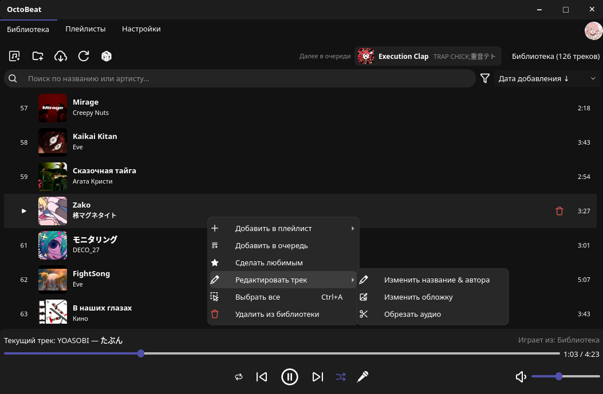

<div align="center">
  


# OctoBeat

A simple music player for your own music files.
No streaming, no subscription.

<p>
  <a href="LICENSE"></a>
  
  
  
</p>

[About](#about) ·
[Features](#features) ·
[Install](#install)

<br>



</div>

## About

I got tired of music streaming services. They felt cluttered and hard to use, and they wanted a monthly subscription. So I decided to build my own player.

OctoBeat has no streaming. Instead, it has other features that make up for it. The main one: you can build a big library of tracks without leaving the app. Search YouTube, download a track, and OctoBeat adds the tags and the cover for you.

It is a personal project, and it is vibe-coded: I built it with the help of AI.

## Features

**Playing music**

- Crossfade between tracks. The length depends on the track (3 seconds at most). You can turn it off in Settings.
- Loudness normalization with ffmpeg, so quiet and loud songs sound about the same.
- Shuffle, repeat (off, all, one) and a queue.
- The app remembers your volume and the last track or playlist you played.
- Plays MP3, FLAC, OGG, M4A, WebM and WAV.

**Library**

- Folders and playlists, with drag and drop.
- Search by title or artist (`Ctrl+F`). Sort by date added, title, artist or duration.
- Playlists can have a cover and a description. There is also a random playlist.
- You can fix a track's `Artist - Title` from the right-click menu.

**Getting music**

- Search YouTube or paste a direct video link and download tracks from inside the app (it uses `yt-dlp`). Audio-only downloads use four parallel fragments where the stream supports them; the download speed is printed to the log in MB/s.
- Download format is selectable in Settings → YouTube: **Speed** keeps the native M4A/WebM stream without re-encoding, while **Compatibility** converts to MP3 320 kbps. M4A tags and the cover are written with `mutagen.mp4`.
- Import a Spotify playlist: export it to CSV with [Exportify](https://exportify.net/), then load the file. OctoBeat finds the tracks, downloads them and adds tags.
- Import files you already have.
- Tags and covers come from [MusicBrainz](https://musicbrainz.org/) and the [Cover Art Archive](https://coverartarchive.org/). If they have nothing, OctoBeat uses the YouTube title and thumbnail.

**Lyrics**

- Synced lyrics, shown next to the player. They come from [syncedlyrics](https://github.com/moehmeni/syncedlyrics) and [LRCLIB](https://lrclib.net/).
- A full-screen karaoke mode with the current line highlighted.
- If the lyrics are a bit early or late, move them by 0.5 seconds.

**Profile (local)**

- A profile with a nickname, avatar, banner and an "About me" text. The text supports BBCode and has a live preview.
- Your favorite track, top tracks and total listening time. There are also achievements with four levels (Bronze, Silver, Gold, Diamond): tracks downloaded, playlists created, listening time and library age.
- Everything is stored in the local database and profile folder.
- Click the avatar in the top-right corner to open the profile. Right-click it to change the avatar or exit the app.

**Other**

- Dark, light, Dracula, Catppuccin and Base2Tone themes, interface zoom, English and Russian.
- Frosted-glass context menus, tooltips, the settings sidebar and the Next in queue card.
- System tray: closing the window hides it to the tray when one is available, otherwise it minimizes to the taskbar. Left-click the tray icon to restore the window; its menu has Open and Exit.
- On Linux, media keys and desktop controls work through MPRIS.

## Install

I develop and test OctoBeat on Linux so if you experience issues on Windows start let me know about it in [issues](https://github.com/ukimaka/OctoBeat/issues).

For manual installation you need:

- Python 3.10 or newer
- ffmpeg (MP3 mode, thumbnail conversion and loudness measurement)
- GStreamer plugins (on Linux, Qt plays audio through GStreamer)

<details>
<summary>Install the system packages</summary>

```bash
# Debian / Ubuntu
sudo apt install python3-venv ffmpeg gstreamer1.0-plugins-good gstreamer1.0-plugins-bad gstreamer1.0-libav

# Arch / Manjaro
sudo pacman -S ffmpeg gst-plugins-good gst-plugins-bad gst-libav
```

On other distributions, install `ffmpeg` and the GStreamer "good", "bad" and "libav" plugins from your package manager.
If a track does not play, a missing GStreamer plugin is the most likely reason.

</details>

Then get the code and run it:

```bash
git clone https://github.com/ukimaka/OctoBeat.git
cd OctoBeat

python3 -m venv .venv
source .venv/bin/activate        # fish: source .venv/bin/activate.fish

pip install -r requirements.txt
python main.py
```

Start the app from the activated virtual environment. OctoBeat looks for `yt-dlp` in your `PATH`, and `pip` installs it into `.venv/bin`.

### Build a standalone binary

OctoBeat ships with a PyInstaller spec file. Install PyInstaller into the same virtual environment and build:

```bash
pip install pyinstaller
pyinstaller OctoBeat.spec
```

The result is `dist/OctoBeat`. The spec bundles the `themes/` and `icons/` folders, PyQt5 and VLC, so the binary does not need the source tree next to it.
