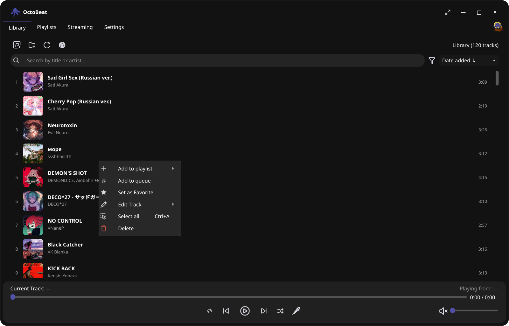
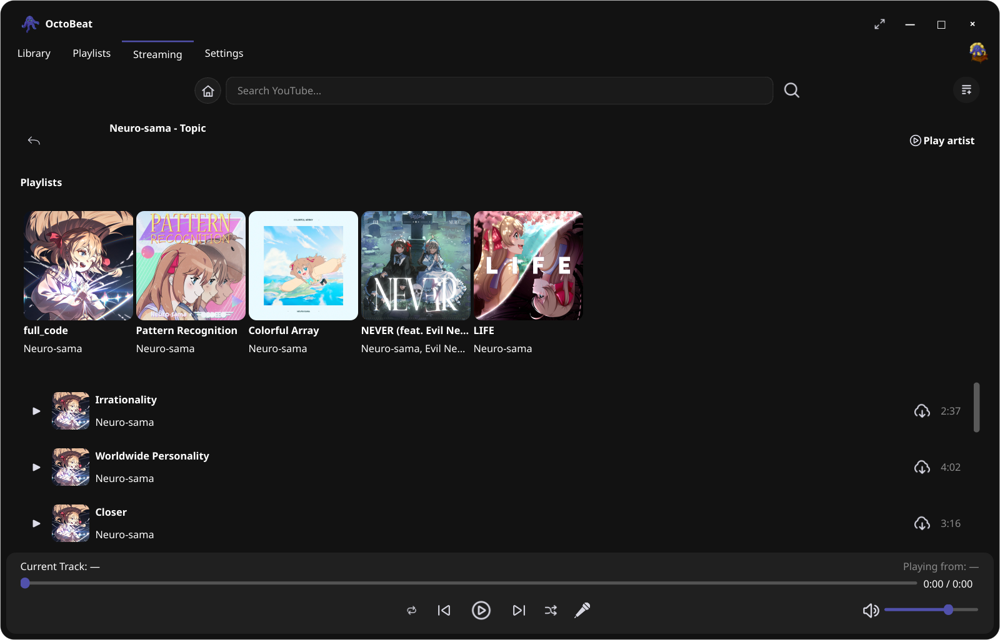
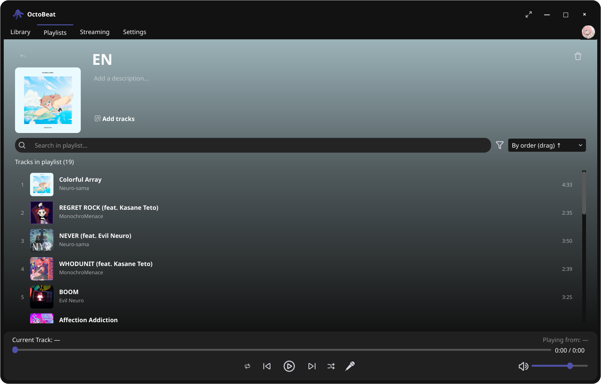
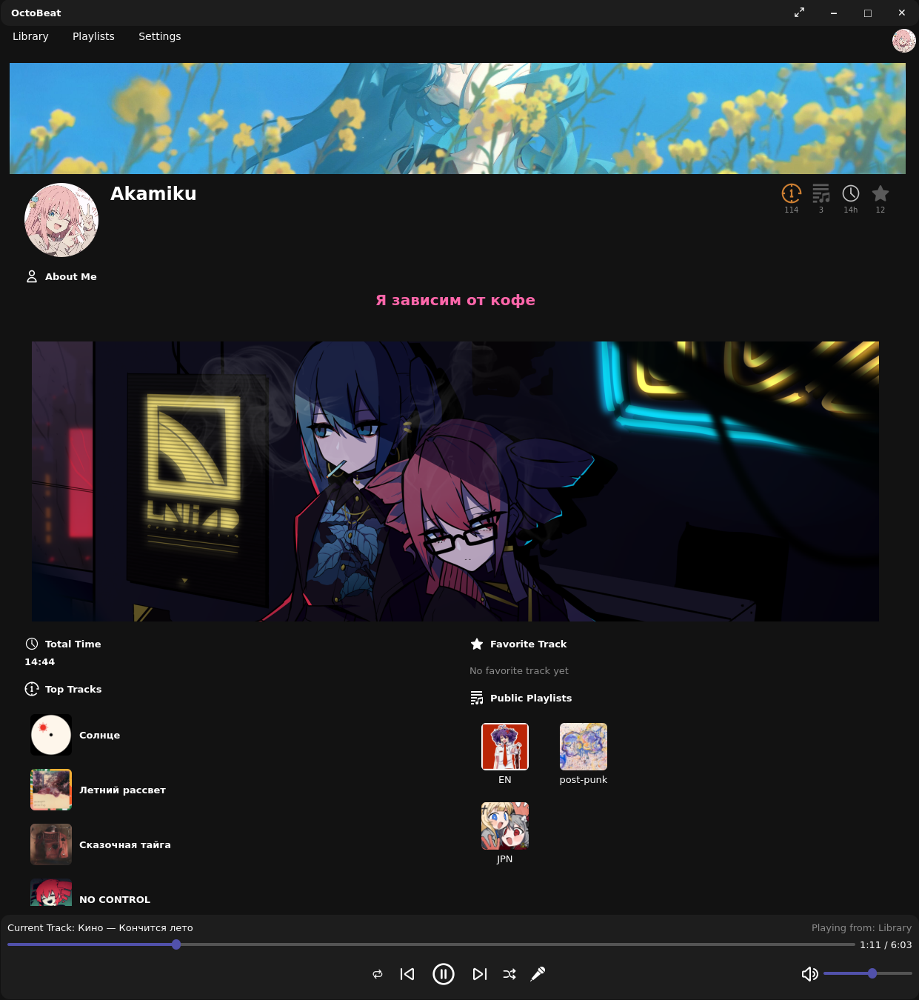
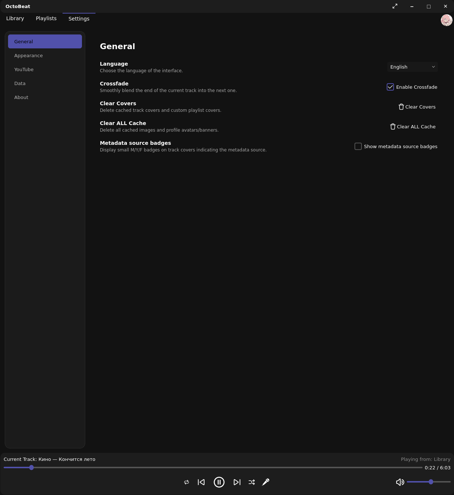
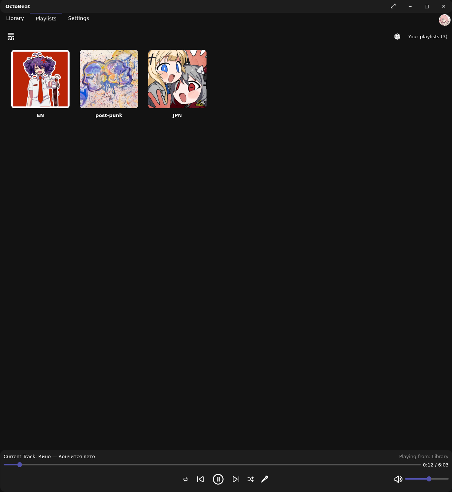
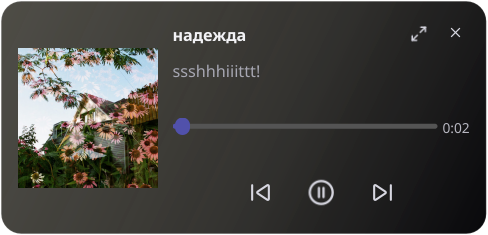

<div align="center">


# OctoBeat

**A native music player for your own library.**
No subscriptions. No VLC. No Python.


[About](#about) · [Features](#features) · [Screenshots](#screenshots) · [Install](#install) · [Build](#build-from-source) · [Under the hood](#under-the-hood)

</div>



## About

I got tired of streaming services. They feel cluttered, they want a monthly
subscription, and they treat your music collection as something you rent.

OctoBeat is the opposite: a desktop player for the files you already own.
It scans your folders, keeps tags and covers in a local SQLite database, and
plays everything through a native Rust audio engine. No browser under the
hood, no VLC, no system Python — the helper binaries shipped with the app are
self-contained.

The optional **Streaming** tab can search YouTube, browse artist pages and
download a track straight into your library, complete with tags and cover art.
Nothing is uploaded anywhere, and no account is required.

This is the Rust/Qt rewrite; the old Python build is retired.

## Features

- **Native audio engine** — Symphonia + cpal. Opus, FLAC (24-bit/192 kHz),
  MP3, AAC/M4A, ADTS, Ogg/Vorbis, ALAC, AIFF and CAF. ALSA/PipeWire on Linux,
  WASAPI on Windows.
- **Your library, your rules** — recursive scanner, folders, search, sorting,
  tag editing, sidecar and embedded covers, playlists with custom covers,
  drag & drop and CSV import.
- **Smooth transitions** — a two-slot crossfade, next-track preload,
  gapless-style switches, fast HLS streaming and a background cache for
  reliable seeking.
- **Desktop integration** — MPRIS media keys, tray icon, frameless window,
  compact mini-player, fullscreen lyrics and karaoke.
- **Streaming, optional** — YouTube search, artists, albums, playlists,
  full discographies, a queue and downloads through SomeDL.
- **Profile and stats** — listening time, top tracks, favorites, achievements,
  a circular avatar and BBCode "About me".
- **Looks and language** — dark and light themes, English and Russian,
  interface zoom from 100% to 150%.
- **Self-contained packages** — bundled yt-dlp, Deno, ffmpeg/ffprobe and a
  frozen SomeDL binary. Nothing to install besides OctoBeat itself.

## Screenshots

| Library | Streaming |
|:---:|:---:|
|  |  |
| **Playlist** | **Profile** |
|  |  |
| **Settings** | **Playlists** |
|  |  |

<p align="center">
  
</p>

## Install

Download the latest build from
[Releases](https://github.com/ukimaka/OctoBeat/releases/latest). Every package
contains yt-dlp, Deno, ffmpeg/ffprobe and a frozen SomeDL binary; Python and
VLC are **not** required. Checksums are published in `SHA256SUMS`.

### Windows

Run `OctoBeat_Setup.exe` and follow the wizard. Windows 10/11 x64.

### Flatpak

```sh
flatpak install --user ./OctoBeat-1.0.0.flatpak
flatpak run io.github.ukimaka.OctoBeat
```

### Arch Linux

```sh
sudo pacman -U ./octobeat-bin-1.0.0-1-x86_64.pkg.tar.zst
```

### Portable Linux

```sh
tar -xzf OctoBeat-1.0.0-Linux-x86_64.tar.gz
./OctoBeat-1.0.0-Linux-x86_64/bin/octobeat
```

Linux builds target x86_64 and use ALSA; PipeWire works through its ALSA
compatibility layer.

## Build from source

Requirements:

- CMake 3.24+ and a C++20 compiler
- Rust stable (cargo)
- Qt 6.5+ with Widgets, Svg, Network and Concurrent
- On Linux: ALSA headers, DBus and pkg-config

```sh
cmake -S . -B build -DCMAKE_BUILD_TYPE=Release
cmake --build build -j
./build/octobeat
```

Install system-wide:

```sh
cmake --install build --prefix /usr/local
```

Rust crates are vendored, so the build works offline.

Packaging scripts:

```sh
packaging/tools/build-linux.sh       # yt-dlp, Deno, ffmpeg, frozen SomeDL
packaging/linux/build-tarball.sh     # dist/OctoBeat-1.0.0-Linux-*.tar.gz
packaging/flatpak/build.sh           # dist/OctoBeat-1.0.0.flatpak
packaging/arch/build-package.sh      # dist/octobeat-bin-1.0.0-1-x86_64.pkg.tar.zst
```

Windows packaging is built by GitHub Actions
([`.github/workflows/release.yml`](.github/workflows/release.yml)) with
Inno Setup.

## Under the hood

| Layer | What it does |
|---|---|
| `rust/core` | SQLite library, scanner, tags, covers, playlists, profile, C ABI |
| `rust/audio-engine` | Symphonia decoding, cpal output, resampling, two-slot crossfade |
| `desktop/` | Qt 6 Widgets UI, MPRIS, mini-player, lyrics, streaming, downloads |
| `packaging/` | Linux tarball, Flatpak, pacman, Windows installer |

The audio engine supports seek and crossfade on local files and streams; the
FIFO fast path is Linux-only, while Windows currently plays streams from the
completed cache.

## License

OctoBeat is licensed under **GPLv3**. Third-party components and their
licenses are listed in [THIRD_PARTY_LICENSES.md](THIRD_PARTY_LICENSES.md).

<div align="center">
<sub>Made for people who still own their music.</sub>
</div>
