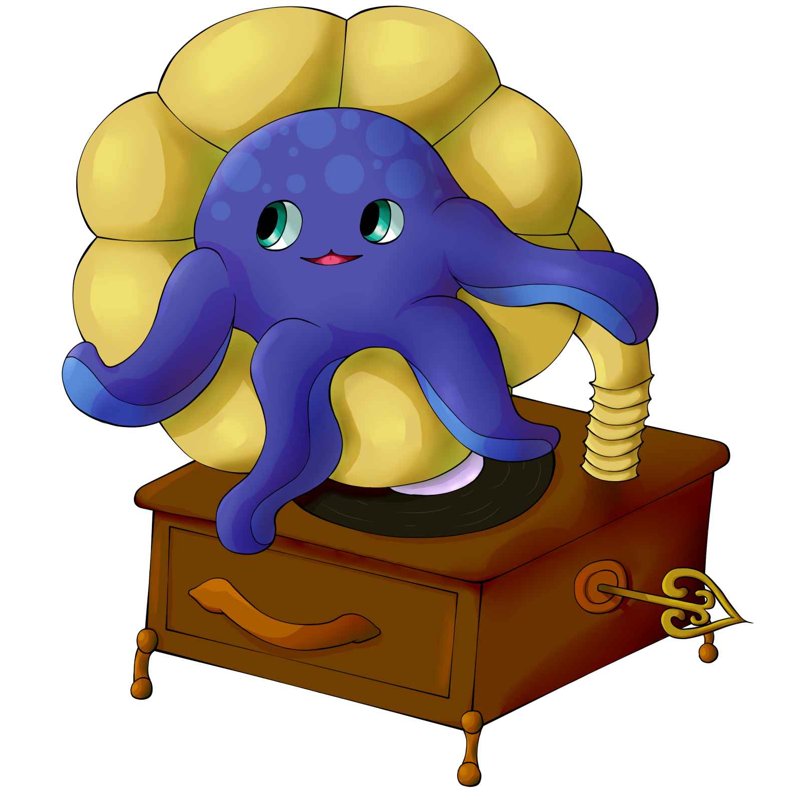
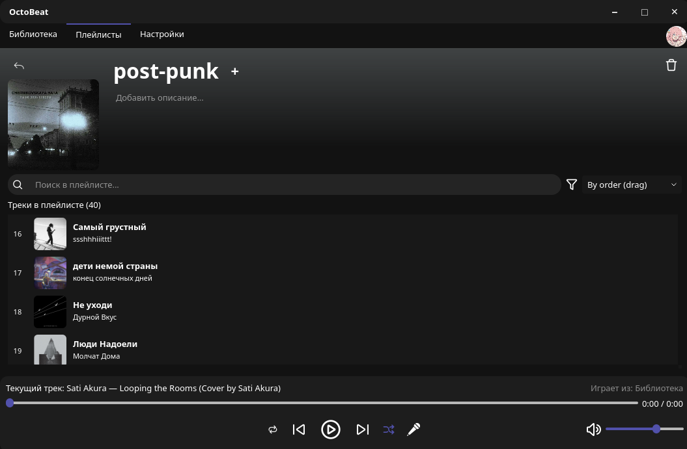
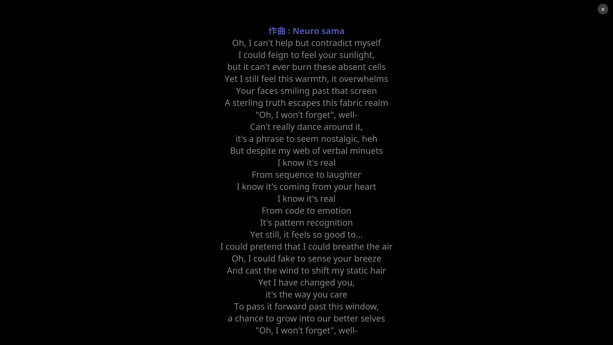
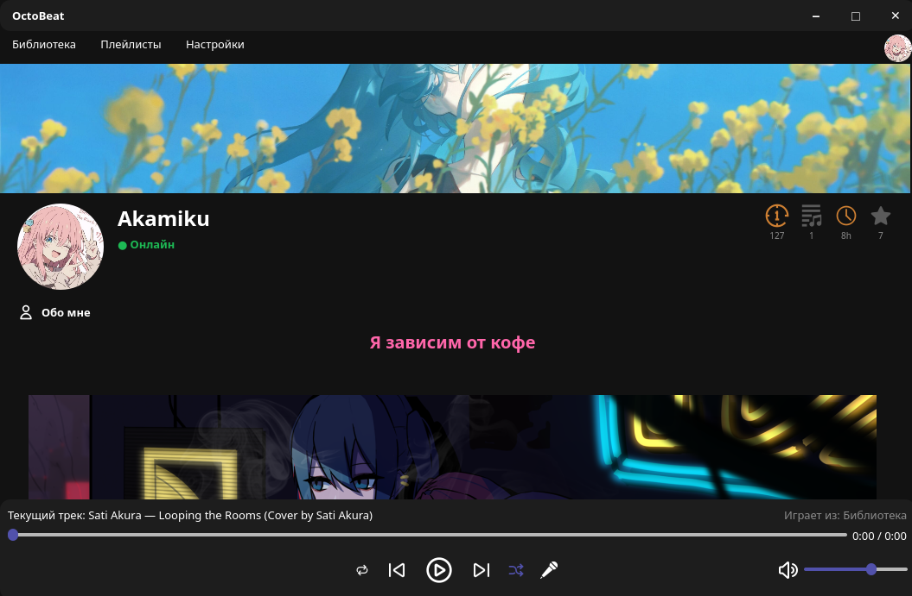
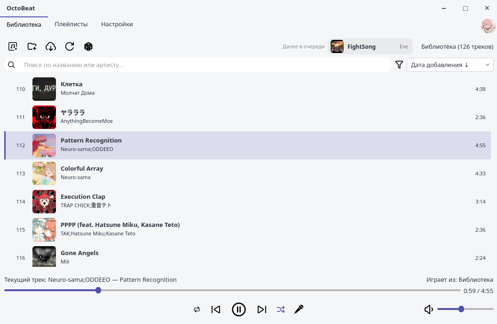

<div align="center">
  


# OctoBeat

A simple music player for your own music files.
No streaming, no subscription.

<p>
  <a href="LICENSE"></a>
  
  
  
</p>

[About](#about) ·
[Features](#features) ·
[Screenshots](#screenshots) ·
[Install](#install) ·
[Usage](#usage) ·
[Limitations](#limitations) ·
[Roadmap](#roadmap)

<br>


</div>

## About

I got tired of music streaming services. They felt cluttered and hard to use, and they wanted a monthly subscription. So I decided to build my own player.

OctoBeat has no streaming. Instead, it has other features that make up for it. The main one: you can build a big library of tracks without leaving the app. Search YouTube, download a track, and OctoBeat adds the tags and the cover for you.

It is a personal project, and it is vibe-coded: I built it with the help of AI. It is still young, so expect rough edges and bugs. See [Limitations](#limitations).

## Features

**Playing music**

- Crossfade between tracks. The length depends on the track (3 seconds at most). You can turn it off in Settings.
- Loudness normalization with ffmpeg, so quiet and loud songs sound about the same.
- Shuffle, repeat (off, all, one) and a queue.
- Plays MP3, FLAC, OGG, M4A and WAV.

**Library**

- Folders and playlists, with drag and drop.
- Search by title or artist (`Ctrl+F`). Sort by date added, title, artist or duration.
- Playlists can have a cover and a description. There is also a random playlist.
- You can fix a track's `Artist - Title` from the right-click menu.

**Getting music**

- Search YouTube and download tracks from inside the app (it uses `yt-dlp`). You get an MP3 with tags and a cover.
- Import a Spotify playlist: export it to CSV with [Exportify](https://exportify.net/), then load the file. OctoBeat finds the tracks, downloads them and adds tags.
- Import files you already have.
- Tags and covers come from [MusicBrainz](https://musicbrainz.org/) and the [Cover Art Archive](https://coverartarchive.org/). If they have nothing, OctoBeat uses the YouTube title and thumbnail.

**Lyrics**

- Synced lyrics, shown next to the player. They come from [syncedlyrics](https://github.com/moehmeni/syncedlyrics) and [LRCLIB](https://lrclib.net/).
- A full-screen karaoke mode with the current line highlighted.
- If the lyrics are a bit early or late, move them by 0.5 seconds.

**Profile and friends (optional)**

- A profile with a nickname, avatar, banner and an "About me" text. The text supports BBCode and has a live preview.
- Your favorite track, top tracks and total listening time. There are also achievements with four levels (Bronze, Silver, Gold, Diamond): tracks downloaded, playlists created, listening time and library age.
- Find people, send and accept friend requests, open a friend's profile and download their playlists.

**Other**

- Dark, light, dracula and catpuccin theme, interface zoom, English and Russian.
- On Linux, media keys and desktop controls work through MPRIS.

## Screenshots

<table>
  <tr>
    <td width="50%"><br><sub>Playlists</sub></td>
    <td width="50%"><br><sub>Karaoke mode</sub></td>
  </tr>
  <tr>
    <td width="50%"><br><sub>Profile</sub></td>
    <td width="50%"><br><sub>Light theme</sub></td>
  </tr>
</table>

## Install

I develop and test OctoBeat on Linux so if you experience issues on Windows start let me know about it in [issues](https://github.com/ukimaka/OctoBeat/issues).

For manual instalation You need:

- Python 3.10 or newer
- ffmpeg (it converts downloads to MP3 and measures loudness)
- GStreamer plugins (on Linux, Qt plays audio through GStreamer)

<details>
<summary>Install the system packages</summary>

```bash
# Debian / Ubuntu
sudo apt install python3-venv ffmpeg gstreamer1.0-plugins-good gstreamer1.0-plugins-bad gstreamer1.0-libav

# Arch / Manjaro
sudo pacman -S ffmpeg gst-plugins-good gst-plugins-bad gst-libav
```

On other distributions, install `ffmpeg` and the GStreamer "good", "bad" and "libav" plugins from your package manager.
If a track does not play, a missing GStreamer plugin is the most likely reason.

</details>

Then get the code and run it:

```bash
git clone https://github.com/ukimaka/OctoBeat.git
cd OctoBeat

python3 -m venv .venv
source .venv/bin/activate        # fish: source .venv/bin/activate.fish

pip install -r requirements.txt
python main.py
```

Start the app from the activated virtual environment. OctoBeat looks for `yt-dlp` in your `PATH`, and `pip` installs it into `.venv/bin`.

## Usage

1. Import your files, or download tracks with the "Download music" button.
2. Make folders and playlists.
3. Covers and tags are loaded on their own. You can open the lyrics and the karaoke mode from the player.
4. If you want a profile and friends, sign in. You can skip this, the player works without an account.

### Hotkeys

| Key | Action |
| --- | --- |
| `Space` | Play / pause |
| `Ctrl` + `→` / `Ctrl` + `←` | Next / previous track |
| `Ctrl` + `↑` / `Ctrl` + `↓` | Volume up / down |
| `Ctrl` + `F` | Search |

### YouTube cookies

Sometimes YouTube tells `yt-dlp` to "confirm you're not a bot", and the download fails. To fix it, give OctoBeat a `cookies.txt` file from a browser where you are signed in to YouTube.

1. Export your YouTube cookies in the Netscape `cookies.txt` format. The [yt-dlp FAQ](https://github.com/yt-dlp/yt-dlp/wiki/FAQ) explains how.
2. Save the file as `~/Music/cookies.txt`, or choose it in Settings > YouTube.

OctoBeat looks for the file in this order: the path from Settings, the download folder, `~/Music/cookies.txt`, the app folder.

> [!WARNING]
> `cookies.txt` gives access to your Google account. Do not share it and do not commit it to a repository.

### Where the data is

| What | Where |
| --- | --- |
| Library and playlists | `music.db` in the app folder |
| Metadata and cover cache | `~/.cache/music_player/` |
| Profile images | `~/.local/share/music_player/profile/` |
| Downloads (default) | `~/Music/` |

Settings > Data can clear the cached covers and images.

## Online features

The account is optional. Without it, OctoBeat sends nothing to its own server. Tags and covers come from MusicBrainz and the Cover Art Archive, lyrics come from the lyrics providers, and downloads come from YouTube.

If you sign in, the app syncs your profile: nickname, "About me", avatar, banner, and some statistics (total listening time, number of tracks and playlists, library age, your favorite track and your top 5 tracks). Your music files are never uploaded.

Profiles and friends work through a small REST server written with FastAPI.

## Limitations

- You can download a friend's playlists, but you cannot publish your own playlists from the app yet.
- Changing the language or the zoom needs a restart.
- The default server is a small hosted instance. It can be slow or offline.
- Only download music you have the right to download. You are responsible for following the laws of your country and the terms of the services you use.

## Roadmap

There are no dates. The list changes as I work on the project.

- [ ] Publish your own playlists (public or private) so friends can download them
- [ ] Likes on profiles
- [ ] Shared playlists
- [ ] Import and export of M3U and YouTube playlists
- [ ] Equalizer, smart playlists, sleep timer, tray icon and mini player
- [ ] ListenBrainz scrobbling
- [ ] "Now listening" status for friends and a yearly summary
- [ ] Android app
- [ ] more languages

If you have an idea, [open an issue](https://github.com/ukimaka/OctoBeat/issues).

## Tech stack

| Part | What I use |
| --- | --- |
| Language | Python 3.10+ |
| GUI and audio | PyQt5 (Qt Widgets and Qt Multimedia) |
| Database | SQLite |
| Tags and metadata | [mutagen](https://mutagen.readthedocs.io/), [musicbrainzngs](https://python-musicbrainzngs.readthedocs.io/) |
| Downloads | [yt-dlp](https://github.com/yt-dlp/yt-dlp) and ffmpeg |
| Lyrics | [syncedlyrics](https://github.com/moehmeni/syncedlyrics), [LRCLIB](https://lrclib.net/) |
| Linux media keys | [mpris-server](https://github.com/alexdelorenzo/mpris_server) |
| Server (optional) | FastAPI |

<details>
<summary>Project layout</summary>

```text
main.py                  entry point
main_window.py           main window
controller.py            playback logic: queue, shuffle, repeat
player.py                CrossfadePlayer (two QMediaPlayer objects)
db.py                    SQLite tables and queries
workers.py               background jobs: import, update info, CSV import
youtube_worker.py        yt-dlp downloads
youtube_dialog.py        YouTube search and download window
musicbrainz_client.py    MusicBrainz and Cover Art Archive, with a cache
metadata.py              reading tags, extracting covers
lyrics_*.py              loading lyrics, lyrics panel
karaoke_overlay.py       karaoke mode
library_tab.py           library view
playlists_ui.py          playlists view
profile_ui.py            profile, stats, achievements
friends_ui.py            friends and requests
api_client.py            client for the optional server
mpris_integration.py     MPRIS (Linux media keys)
translations.py          English and Russian texts
styles.py, appearance.py themes and scaling
icons/                   SVG icons (see THIRD_PARTY_LICENSES.md)
```

</details>

## Contributing

Bug reports and ideas are welcome. The easiest way is to [open an issue](https://github.com/ukimaka/OctoBeat/issues). In the app, Settings > Report a Bug opens the same page.

If you want to change the code, fork the repository, make a branch and open a pull request. Please say what you changed and how you tested it, and keep the GPL header at the top of new files.

## License

OctoBeat is licensed under the [GNU General Public License v3.0](LICENSE). The icons are from [SVG Repo](https://www.svgrepo.com/) under open licenses, see [THIRD_PARTY_LICENSES.md](THIRD_PARTY_LICENSES.md).

Thanks to MusicBrainz and the Cover Art Archive for the metadata, LRCLIB for the lyrics, and the authors of yt-dlp, mutagen and PyQt5.
